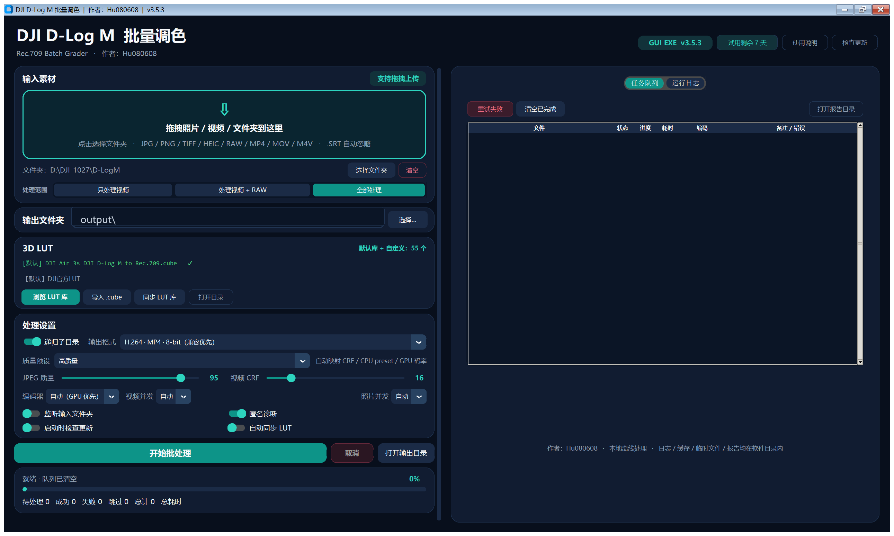
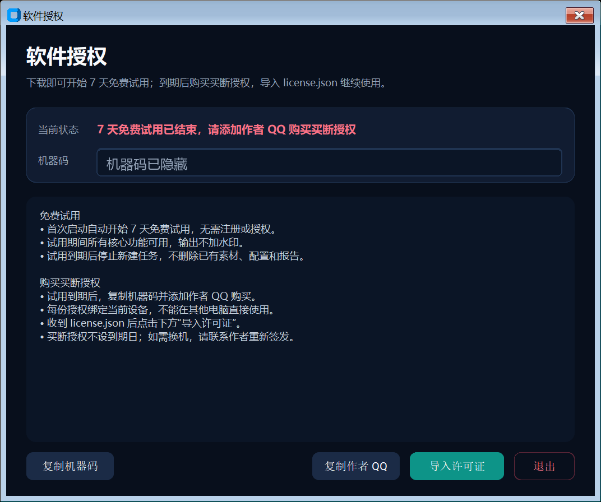

# DJI D-Log M Batch Grader

**作者：Hu080608**  
**版本：3.7.2**  
**平台：Windows 10/11 x64**  
**许可：商业软件，买断授权**

DJI D-Log M Batch Grader 是一款面向 DJI 旗下设备拍摄素材的批量 LUT 调色与色彩还原工具。它把照片、视频、LUT 选择、GPU/CPU 编码、并发处理、失败重试和结果报告放在同一个桌面程序里，减少在多个工具之间来回切换的时间。

软件可以从 GitHub Releases 免费下载，**下载后即可自动开始 7 天免费试用**，无需注册或授权文件。试用结束后如需继续使用，请联系作者购买买断授权并导入 `license.json`。

---

## 解决痛点

航拍一次往往会产生大量照片和视频，D-Log / D-Log M 素材必须先完成色彩还原，才能进入剪辑、调色或交付流程。市面主流软件大多围绕单条素材设计，面对成批文件时，导入、套 LUT、选择编码、管理队列和检查失败项都需要反复操作，效率低，也容易漏处理。

本工具将批量导入、DJI 官方 LUT 匹配、GPU/CPU 编码、并发处理、失败重试和结果报告整合为一套本地离线工作流，让大批量素材的色彩还原更快、更稳定、更容易检查。

---

## 核心优势

- **照片和视频统一处理**：支持 JPG、PNG、TIFF、HEIC、常见相机 RAW（DNG/CR2/CR3/NEF/ARW 等）以及 MP4、MOV、M4V。
- **内置 DJI 官方 LUT 库**：内置 55 个 DJI 官方 3D LUT，覆盖 25 个设备/系列。
- **热门网络 LUT 分区**：新增 30 个 D-Log M 直用风格 LUT，累计 58 个，按电影感、胶片风、日系清新、赛博朋克、复古暖调、自然风光、冷调夜景、黑白纪要和实验风格分类。
- **硬件性能优先**：自动探测 NVIDIA NVENC、Intel QSV、AMD AMF，真实试编码失败后自动回退 CPU；LUT 为 CPU 滤镜时默认软件解码以避免显存往返，编码仍优先使用硬件。
- **批量任务可控**：视频/照片独立并发，支持“只处理视频 / 视频 + RAW / 全部处理”三种范围，任务队列持续显示待处理项，失败可单独重试，逐文件记录处理耗时。
- **RAW 完整处理**：LibRaw 解码 → 相机白平衡 → sRGB → LUT → 16-bit TIFF 输出，保留 RAW 位深。
- **总耗时明确可见**：日志和界面均显示“本次处理总耗时”，格式为时:分:秒。
- **输出兼容后期流程**：支持 H.264 MP4、H.265/HEVC MP4 8-bit、HEVC MP4 10-bit、ProRes 422 HQ MOV 10-bit。
- **音频优先保留**：原音频优先复制；目标容器不兼容时自动回退 AAC/PCM，并尽量保留多音轨、章节和元数据。
- **本地离线**：素材不上传；LUT、日志、报告、缓存和临时文件都保存在软件目录内。

### 适用场景

- DJI 航拍照片批量色彩还原
- D-Log / D-Log M 视频批量转 Rec.709
- 需要交付 H.264、HEVC 10-bit 或 ProRes 母版的后期流程
- 需要监听文件夹并自动处理新素材的工作流
- 需要失败重试、耗时记录和批次报告的小型工作室

---

## 运行截图



*主界面：拖入素材后，待处理任务会立即显示在任务队列中；右侧可查看状态、进度、编码器、耗时和备注。*



*授权窗口：7 天试用到期后可复制机器码、联系作者购买买断授权、导入授权文件。*

---

## 快速开始

### 1. 下载

打开 GitHub Releases：

```text
https://github.com/Hu080608/DJI-BatchGrader/releases
```

下载最新的：

```text
DJI_DLogM_BatchGrader_Windows_x64_v3.7.2.zip
```

### 2. 解压并启动

将 ZIP 解压到任意可写目录，保留完整文件夹结构，双击：

```text
DJI_DLogM_BatchGrader.exe
```

无需安装 Python，无需单独安装 FFmpeg。

### 3. 免费试用

首次启动会**自动开始 7 天免费试用**，无需注册、无需授权文件：

- 试用期间核心功能全部可用；
- 输出不加水印；
- 试用状态绑定当前机器码；
- 到期后停止新建任务，但不会删除已有文件、配置、报告和日志。

### 4. 购买买断授权

试用到期后，如需继续使用：

1. 打开“授权信息”，点击“复制机器码”；
2. 添加作者 QQ：**3643791089**；
3. 提供机器码并购买买断授权；
4. 收到 `license.json` 后，点击“导入许可证”。

买断授权不设到期日，绑定当前设备。

### 5. 开始使用

按界面提示选择素材、LUT、输出目录和格式，点击“开始批处理”。

---

## 基本用法

1. **导入素材**：把照片、视频或文件夹拖入左上角拖拽区域，或点击“选择文件夹”（JPG/PNG/TIFF、HEIC、RAW、MP4/MOV/M4V）。
2. **选择处理范围**：默认“全部处理”；也可选择“只处理视频”或“处理视频 + RAW”。范围外的普通照片会被跳过并计数，不会中断批处理。
3. **选择输出目录**：默认输出到软件目录下的 `output\`。
4. **选择 LUT**：点击“浏览官方LUT库”“浏览网络热门LUT库”或“浏览自定义LUT库”；各入口按设备/风格分组，也可以导入自己的 `.cube`。
5. **选择输出格式**：按交付需求选择 H.264、HEVC 8-bit、HEVC 10-bit 或 ProRes。
6. **开始处理**：点击“开始批处理”；右侧任务队列会显示每个文件的进度、编码器、耗时和错误信息。
7. **查看结果**：任务完成后打开输出目录；报告位于 `reports\`，界面和日志会显示本次处理总耗时。

支持自动监听输入文件夹：开启后，新素材会自动加入队列，当前批次结束后继续处理下一批。

任务队列每次启动都会自动清空，不删除配置、报告或历史记录。右键单个任务项提供“开始 / 重试 / 取消 / 删除”操作；删除只移除队列项，不删除源文件；批处理运行中菜单为只读。

---

## 支持的输出格式

| 格式 | 适用场景 |
|---|---|
| H.264 MP4 8-bit | 兼容性优先，直接分享 |
| H.265/HEVC MP4 8-bit | 更小体积，适合网络传输 |
| H.265/HEVC MP4 10-bit | 保留更多暗部和天空渐变 |
| ProRes 422 HQ MOV 10-bit | 剪辑母版和专业后期 |
| RAW → 16-bit TIFF | 保留 RAW 解码位深和 sRGB 色彩 |

---

## 配置说明

配置文件：

```text
config\settings.json
```

常用设置：

- `output_dir`：默认输出目录；输入目录不写入配置，每次启动为空
- `recursive`：是否扫描子目录
- `import_scope`：`all`（全部）/ `video_raw`（视频 + RAW）/ `video_only`（只处理视频）
- `output_profile`：输出格式
- `quality_preset`：极致画质 / 高质量 / 标准 / 极速 / 自定义
- `video_lut_interp`：`tetrahedral`（默认）/ `trilinear` / `nearest`
- `video_workers` / `photo_workers`：并发数，`0` 表示自动
- `encoder_preference`：`auto` / `cpu` / `nvidia` / `intel` / `amd`
- `audio_policy`：音频复制优先或强制 AAC
- `watch_enabled`：监听输入文件夹
- `write_reports`：生成 JSON / CSV 报告

一般用户无需手动编辑配置，直接在界面中调整即可。

---

## 常见问题

### 下载后可以直接使用吗？

可以。首次启动会自动开始 **7 天免费试用**，无需注册或授权文件。

### 试用结束后怎么办？

试用到期后停止新建任务，但不会删除已有文件、配置和报告。复制机器码并添加作者 QQ：**3643791089** 购买买断授权，导入 `license.json` 后继续使用。

### 支持哪些 RAW 格式？

支持 LibRaw 常见 RAW 扩展名，包括 DNG、CR2、CR3、NEF、NRW、ARW、SRF、SR2、RAF、RW2、ORF、PEF、SRW、3FR、FFF、IIQ、KDC、MEF、MOS、MRW、X3F 等。RAW 会以相机白平衡、sRGB 色彩处理，并输出 16-bit TIFF（文件名后缀 `_graded.tif`）。

### 处理范围切换后普通照片会怎样？

选择“只处理视频”或“处理视频 + RAW”时，JPG/PNG/TIFF/HEIC 等普通照片会被跳过，不会报错或中断；界面和日志会显示范围跳过数量。

### 如何购买正式授权？

添加作者 QQ：**3643791089**，提供机器码和购买信息。买断授权不设到期日，绑定当前设备。

### 换电脑怎么办？

在新电脑复制新的机器码，联系作者重新签发授权。授权文件不能直接复制到另一台电脑使用。

### 为什么没有使用 GPU？

程序会自动探测可用编码器，探测或驱动不可用时自动回退 CPU。也可以在界面中手动选择编码器偏好。

### 输出视频没有声音？

程序优先复制音频，不兼容时自动回退 AAC/PCM。如果仍然异常，请检查源文件音频流和输出格式设置。

### 如何更新软件？

应用更新只从 GitHub Releases 检查。确认更新后主窗口会关闭，并打开独立的更新进度页；进度页会持续显示下载、SHA-256 校验、解压、安装和启动新版本状态，支持断点续传、失败重试和退出回到旧版本。更新会保留配置、自定义 LUT、授权、输出、日志和报告。更新成功后会自动清理 `updates/`，最多保留当前版本和 1 个上一版本更新包。

---

## 许可证与致谢

- 本软件为**商业软件**，不是开源软件。
- 公开仓库仅用于软件下载、用户文档和问题反馈，不提供源码或授权签发工具。
- 软件可以从 GitHub 免费下载，并自动开始 7 天免费试用；试用结束后继续使用需要购买买断授权。
- 购买、续费和授权咨询请添加作者 QQ：**3643791089**。
- DJI、D-Log、D-Log M 和相关标识归 DJI 所有；本项目与 DJI 无隶属或官方背书关系。
- 内置 DJI LUT 来自 DJI 官方下载渠道，来源和校验信息见 `luts\SOURCES.md` 与 `luts\manifest.json`。
- 本软件包含第三方组件，详见 `THIRD_PARTY_NOTICES.md`。
- 使用本项目即表示你已阅读并同意 `LICENSE.txt` 和 `COPYRIGHT.md`。
